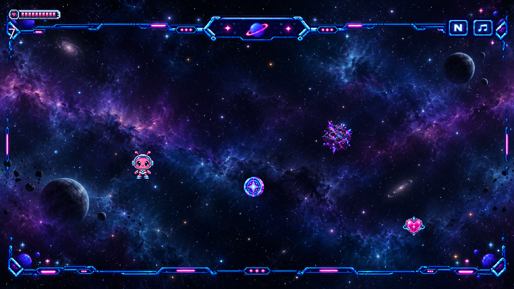
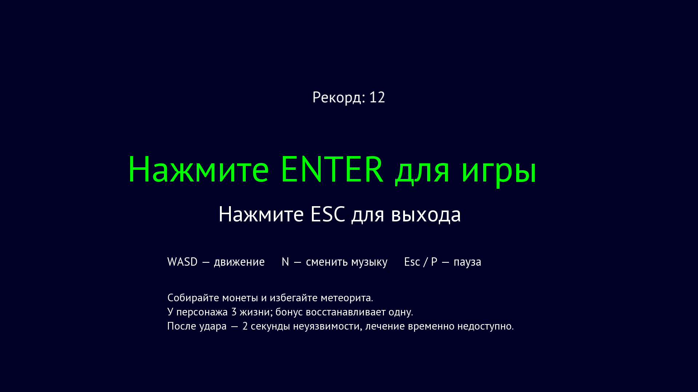
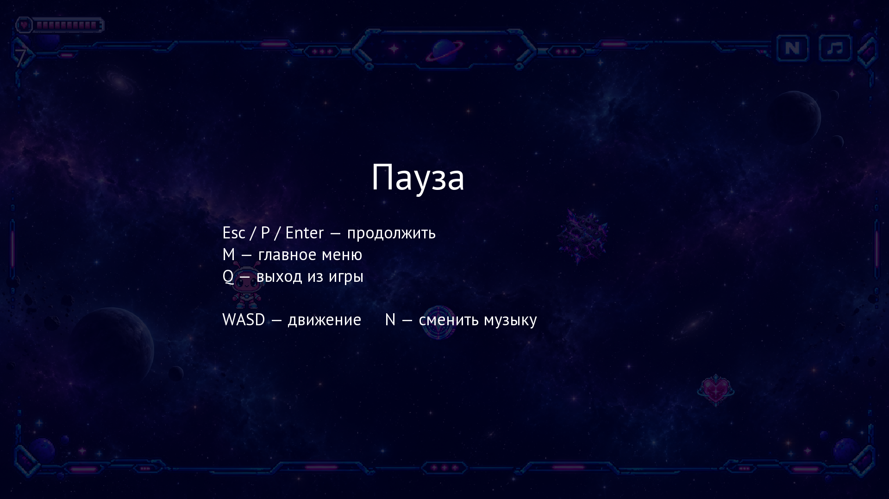
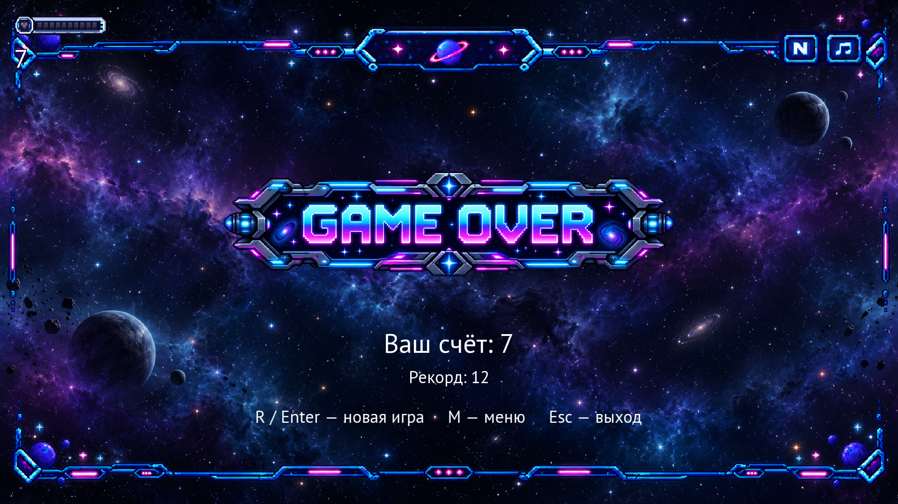

# Space Adventure Game

Небольшая космическая 2D-аркада на C++17 и SFML 3.0.2: управляйте космическим персонажем, уворачивайтесь от метеорита и соберите как можно больше монет до потери трёх жизней.

Учебный проект [Sergviva1](https://github.com/Sergviva1). Игровой цикл реализован; подготовка к публичному релизу ещё не завершена. Условия собственных ресурсов оформлены, разрешение распространять музыку подтверждено автором проекта. Runtime обновлён из текущего MSYS2 UCRT64, SFML сопоставлен с предоставленным комплектом. Автор подтвердил скачивание проверенного локального архива SFML с официального сайта; независимое сравнение с официальной копией не выполнено. Исходники runtime подготовлены для отдельной публикации рядом с игрой. Перед релизом остаются вопрос старых ресурсов в истории Git, ручная визуальная и звуковая проверка и публикация обоих архивов (см. [SPEC.md](SPEC.md) и [CREDITS.md](CREDITS.md)). Готовая сборка пока не опубликована.



<details>
<summary>Меню, пауза и экран поражения</summary>





</details>

Снимки получены из настоящего рендера игры; позиции объектов и счёт заданы сценарием `tests/capture.cpp` для демонстрации, а не записаны во время прохождения.

## Правила и возможности

- Монета даёт одно очко; метеорит отнимает одну жизнь и возвращает персонажа на стартовую позицию.
- После урона персонаж мигает и не получает повторный урон 2 секунды.
- Бонус восстанавливает одну жизнь, но не расходуется при полном здоровье или во время неуязвимости.
- Меню, пауза, экран поражения с итоговым счётом и повторный старт без перезапуска приложения.
- Рекорд между запусками: показан в меню и на экране поражения, не сбрасывается при новой партии.
- Анимация персонажа, прокручиваемый фон, звуковые эффекты и три переключаемых зацикленных музыкальных трека.
- Полноэкранное отображение в разрешении рабочего стола; игровая область 1920×1080 масштабируется с сохранением пропорций (при необходимости с чёрными полями).

## Запуск

Соберите проект по инструкции ниже. Каталоги `assets/` и исполняемые DLL должны находиться рядом с `main.exe`. Игру можно запускать из любой рабочей папки.

Для запуска из репозитория выполните `.\main.exe` в PowerShell или `main.exe` в Command Prompt.

## Управление

- **В меню:** `Enter` — начать игру, `Esc` — выйти.
- **Во время игры:** `WASD` — движение корабля, `N` — сменить музыку, `Esc` или `P` — пауза.
- **На паузе:** `Esc`, `P` или `Enter` — продолжить, `M` — вернуться в меню, `Q` — выйти.
- При потере фокуса окна игра автоматически ставится на паузу. Для продолжения вернитесь в окно и нажмите клавишу возобновления.
- **После поражения:** `R` или `Enter` — новая игра, `M` — вернуться в меню, `Esc` — выйти.

## Требования

Для запуска: Windows x64, графическая и звуковая подсистемы, совместимые с SFML 3, ресурсы и DLL из раздела ниже. Компилятор нужен только для сборки.

Для сборки:

- MSYS2 UCRT64 с MinGW-w64 GCC и GNU Make (`mingw32-make`). Сборка проверена с GCC 15.2.0 и GNU Make 4.4.1.
- SFML 3.0.2 уже находится в `src/include` и `src/lib`; отдельно устанавливать SFML для сборки не требуется.

В терминале MSYS2 UCRT64 установите инструменты командой:

```text
pacman -S --needed mingw-w64-ucrt-x86_64-gcc mingw-w64-ucrt-x86_64-make
```

## Сборка

Откройте Windows Command Prompt, PowerShell или MSYS2 UCRT64 с `g++` и `mingw32-make` в `PATH`, перейдите в корень репозитория и выполните:

```text
mingw32-make
```

Исполняемый файл появится как `main.exe`. Makefile запускает компилятор из `%LOCALAPPDATA%\Temp`, чтобы runtime-DLL игры не конфликтовали с DLL GCC в корне репозитория.

Очистить результат сборки:

```text
mingw32-make clean
```

## Сохранение рекорда

Рекорд обновляется сразу при сборе монеты, если результат превышает прежний, и сохраняется в `%LOCALAPPDATA%\SpaceAdventure\highscore.txt`. Папка создаётся автоматически. Все установленные копии игры в одном профиле используют этот файл; рабочая папка и доступ на запись рядом с `main.exe` не важны. Для сброса рекорда закройте игру и удалите файл.

Отсутствующий или повреждённый файл считается нулевым рекордом. Запись выполняется через временный файл с последующей заменой: ошибка не должна уничтожать прежний результат. Если сохранить не удалось, игра продолжает работать, рекорд остаётся в памяти, а в меню и на экране поражения появляется пометка «не сохранён»; при следующем сборе монеты запись будет повторена. Сохранения игрока не включаются в архив сборки.

## Локальный архив сборки

```text
mingw32-make dist
```

Команда пересобирает игру, запускает smoke-проверку и создаёт `dist/SpaceAdventure-local-win64.zip` с `main.exe`, ресурсами, семью необходимыми DLL, документацией и контрольными суммами SHA-256. Требуется Windows PowerShell 5.1 или новее. Распакуйте архив целиком и запустите `main.exe`; компилятор на машине запуска не требуется.

Проверить архив после распаковки:

```text
mingw32-make dist-check
```

Проверка сверяет SHA-256, состав DLL и отсутствие тестовых EXE в архиве, затем запускает smoke-тест в распакованной копии и саму игру на 3 секунды. Используется временный путь с пробелами и кириллицей, другая рабочая папка и `PATH` только с системными каталогами Windows. Во время проверки появляется полноэкранное окно; не запускайте её параллельно с другими игровыми проверками. Проверка не заменяет тест на отдельной чистой Windows-машине.

Это **локальная проверочная сборка, не публичный релиз**. Графика и эффекты предоставлены под CC0 в пределах прав автора; разрешение распространять музыку вместе с игрой подтверждено автором проекта. Источник проверенного локального архива SFML подтверждён автором. Подготовлен отдельный архив исходников runtime, который необходимо публиковать рядом с игрой (см. [инструкцию](licenses/runtime-sources.md)). Перед публикацией остаются вопрос старых ресурсов в истории Git и ручное прохождение; подробности — в `CREDITS.md` и `licenses/README.md`. `dist/` исключён из Git. Скрипт `scripts/package.ps1` также принимает `-Version`, но сам ничего не собирает и не тестирует — штатная команда для проверяемого архива именно `mingw32-make dist`.

## Файлы для запуска

Для запуска `main.exe` рядом с ним должны находиться папка `assets/` и следующие DLL:

- `libgcc_s_seh-1.dll`
- `libstdc++-6.dll`
- `libwinpthread-1.dll`
- `sfml-audio-3.dll`
- `sfml-graphics-3.dll`
- `sfml-system-3.dll`
- `sfml-window-3.dll`

Шрифт PT Sans поставляется в `assets/`; его лицензия находится в `assets/PT_Sans-LICENSE.txt`. Условия остальных ресурсов — в [assets/LICENSE.md](assets/LICENSE.md), источники и границы подтверждения — в [CREDITS.md](CREDITS.md).

## Лицензия

Авторский код игры, тестов и скриптов, а также авторская документация доступны по [лицензии MIT](LICENSE). Она разрешает использование, изменение и распространение с сохранением уведомления об авторстве и текста лицензии.

MIT не распространяется на `assets/`, сторонние библиотеки, их заголовки и runtime-DLL. Собственная графика и эффекты предоставлены под [CC0 1.0 Universal](licenses/CC0-1.0.txt) в пределах прав автора; шрифт — под SIL OFL. Музыка Zvukogram распространяется вместе с игрой по подтверждению автора проекта и не перелицензируется под CC0/MIT. Точные списки файлов и исключения — в [assets/LICENSE.md](assets/LICENSE.md), источники — в [CREDITS.md](CREDITS.md).

Уведомления SFML, встроенных компонентов и MinGW-w64/GCC находятся в [licenses/](licenses/README.md) и включаются в ZIP. При распространении сохраняйте этот каталог. SFML DLL побайтно совпали с предоставленной автором папкой `SFML-3.0.2/`; также проверен локальный ZIP, скачивание которого с официального сайта SFML прямо подтвердил автор. Независимое сравнение с официальной копией не выполнено (см. [протокол](licenses/SFML-verification.md)). Три runtime-DLL обновлены из установленного MSYS2 UCRT64: GCC runtime `15.2.0-8`, winpthreads `13.0.0.r124.g2717de84e-1`. Версии, источник и границы проверки описаны в `licenses/README.md`. Соответствующие исходные пакеты runtime проверены: подписи MSYS2 корректны, рецепты совпали с `.BUILDINFO` бинарных пакетов. Подготовить отдельный ZIP можно командой `powershell -NoProfile -ExecutionPolicy Bypass -File scripts/package-runtime-sources.ps1`. Его необходимо публиковать рядом с игровым ZIP с равнозначным доступом; инструкция и границы проверки — в [licenses/runtime-sources.md](licenses/runtime-sources.md). Наличие уведомлений само по себе не заменяет предоставление исходников.

## Замена текстур

Игра загружает картинки по обычным именам из `assets/`. Неиспользуемые резервные текстуры, старая музыка и старые WAV-эффекты удалены из рабочей копии.

- `spritelist.png`: лист **166×260**, два кадра **166×130** друг под другом.
- `healthbar.png`: **312×311**; полная полоска в области `(0, 0, 312, 104)`, пустая — `(0, 207, 312, 104)`. Заполнение для 1/2/3 жизней формируется кодом.
- `meteor.png`, `coin.png`, `bonus.png`: масштабируются с сохранением пропорций в пределах **125×125**, **96×96** и **92×92** соответственно, независимо от исходного разрешения.
- `gameover.png`: вписывается в **1000×340** и центрируется.
- `space.png`, `gamepanel.png`: заполняют экран **1920×1080**; желательно соотношение сторон **16:9**. Панель — прозрачная рамка экрана.
- Для спрайтов нужен прозрачный фон без больших пустых полей: столкновения пока считаются по прямоугольнику спрайта.

Замена изображения не подтверждает права на его распространение; источники и лицензии фиксируются в `CREDITS.md`.

## Проверка изменений

```text
mingw32-make clean
mingw32-make
mingw32-make smoke
```

Smoke-проверка открывает и скрывает игровое окно, поэтому ей нужны доступ к рабочему столу, графика, аудио и все игровые ресурсы; это не headless-тест. Проверяются границы движения, однократный сбор монеты, лечение, неуязвимость, пауза/возобновление музыки, ограничение шага времени, поражение, рестарт, возврат в меню, выход и бесшовность прокрутки фона. Также проверяются сохранение и повторное чтение рекорда, повреждённые данные, переполнение счёта, блокировка файла, сохранность прежнего результата при ошибке и повторная запись после неё. Тесты работают со своей временной папкой и не изменяют рекорд игрока. Ожидаемые сообщения «Не удалось сохранить рекорд» во время проверки означают намеренно созданные ошибки записи, а не падение теста. Доступ к внутренним полям через GCC `-fno-access-control` включён только для тестовой сборки.

Переснять демонстрационные экраны можно командой `mingw32-make screenshots`. Она сохраняет четыре PNG в `docs/screenshots/`, не изменяет игровые ресурсы и требует рабочего стола, как smoke-проверка. Разрешение снимков соответствует текущему экрану.

Вручную перед релизом: проверить читаемость меню/паузы на разных экранах, движение WASD (в том числе по диагонали), удержание `N` и клавиш меню, `Alt+Tab`, продолжение аудио на слух и полный маршрут до поражения. Автоматическая проверка этого не заменяет.
